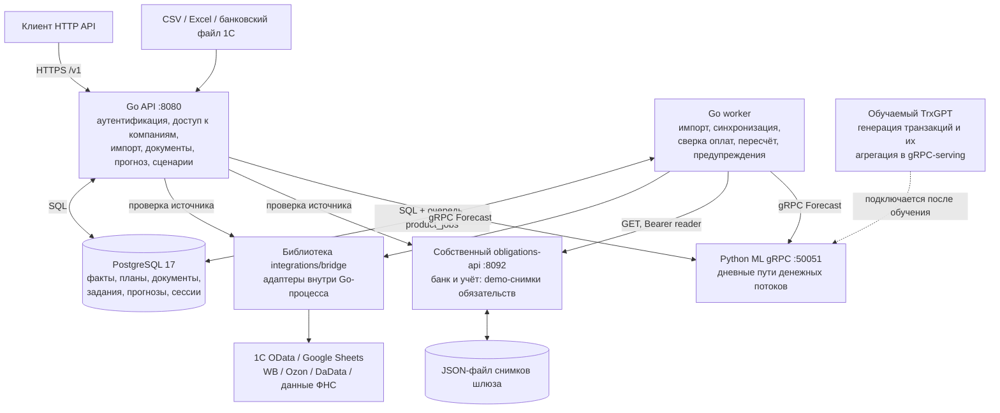
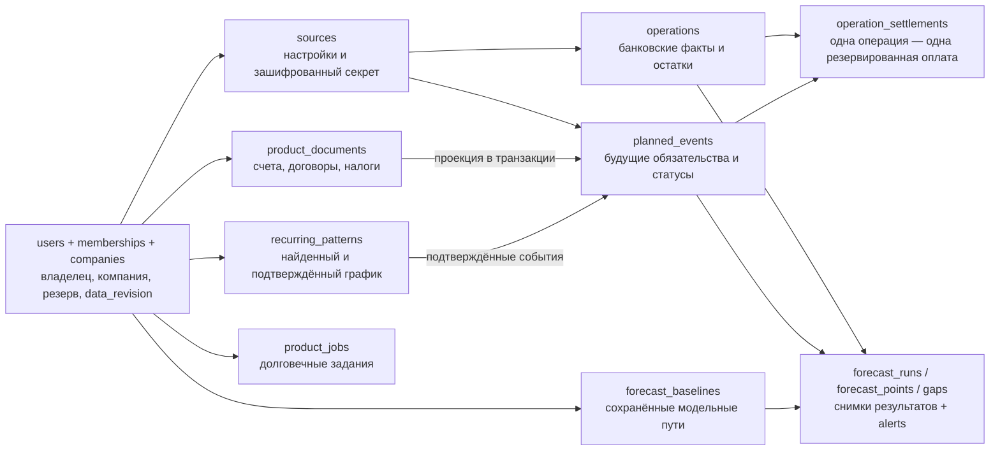
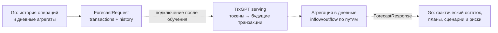

# Архитектура Пульса

Актуально для backend ветки `documents` на 25 октября 2026 года. Схемы показывают реализованный прототип. Команды запуска и проверки находятся в [README.md](README.md). Диаграммы написаны в Mermaid и отображаются средствами просмотра Markdown с поддержкой Mermaid.

## Компоненты



API и worker используют одну библиотеку `internal/product` и одну БД. Адаптеры `integrations/bridge` вызываются из backend напрямую. Дополнительный процесс Hub для общих снимков ФНС подключается через конфигурацию и является внешним источником относительно этого контура. Собственный шлюз обязательств запускается отдельно; в основном Compose он не объявлен.

Прогноз и сценарий можно получить синхронно. Долгие импорты, экспорты, синхронизации и фоновый пересчёт идут через PostgreSQL-очередь. Redis и отдельный брокер сообщений в этом пути не используются.

## Границы модулей

| Модуль | Ответственность |
| --- | --- |
| `backend/cmd/api`, `internal/httpapi` | HTTP, DTO из OpenAPI, обработка запросов и ошибок |
| `internal/platform` | Регистрация, сессии, пароли, OAuth, компании и права доступа |
| `internal/product` | Документы, планы, источники, план-факт, сценарии, риски и задания |
| `internal/ingest`, `internal/categorize` | Нормализация, дедупликация, дневные потоки и категории |
| `internal/forecast` | gRPC-клиент, проверка путей, резервная модель, сборка остатка и квантилей |
| `internal/risk` | Выявление разрывов по траекториям относительно резерва |
| `internal/store`, `backend/migrations` | SQL-хранилище, транзакции, проекции документов и миграции |
| `integrations/bridge`, `integrations/internal/providers` | Адаптеры внешних данных и нормализованные контракты |
| `internal/obligations`, `internal/obligationapi` | Протокол обязательств и собственный демонстрационный провайдер |
| `proto/forecast/v1` | Общая граница Go и ML: запрос истории, ответ путей |

## Что хранится



Стрелки этой схемы обозначают принадлежность и потоки данных; это не полный набор внешних ключей. Например, `operation_settlements.event_id` — аудиторская ссылка, которая сохраняется и при перестроении/удалении проекции документа. Уникальность `(company_id, operation_id)` не позволяет одной банковской операции оплатить два обязательства. Загрузка файлов и выгрузка результатов используют также `product_uploads` и `product_downloads`.

Все финансовые сущности принадлежат компании. Проверка `memberships` выполняется до доступа к данным. Критические изменения блокируют строку компании, изменяют `data_revision` и ставят пересчёт в той же транзакции. Снимок прогноза содержит ревизию, чтобы действие на основе старого прогноза не применялось к уже изменённым данным.

## От загрузки до предупреждения

```mermaid
sequenceDiagram
    participant C as Клиент
    participant A as Go API
    participant P as PostgreSQL
    participant W as Worker
    participant S as Источник
    participant M as ML gRPC
    C->>A: Загрузить файл / запустить синхронизацию
    A->>P: Сохранить вход и задание
    A-->>C: 202 + job_id
    W->>P: Забрать задание FOR UPDATE SKIP LOCKED
    W->>S: Прочитать данные при синхронизации
    S-->>W: Операции / полный снимок обязательств
    W->>W: Проверить принадлежность и нормализовать
    W->>P: Атомарно записать данные, ревизию и recompute
    W->>P: Сопоставить оплаты с планами
    W->>P: Прочитать фактический остаток и модельный baseline
    alt Можно использовать будущие пути
        W->>W: Взять суффикс путей и новый фактический остаток
    else Нужен новый прогноз модели
        W->>M: Дневная история + операции + горизонт с запасом
        M-->>W: Пути поступлений и расходов
        W->>P: Сохранить baseline
    end
    W->>W: Составить планы, остатки, квантили и риски
    W->>P: Сохранить прогноз и предупреждения; завершить задание
    C->>A: Получить задание / прогноз / план-факт
    A->>P: Прочитать данные компании
    A-->>C: Результат со статусом, источниками и объяснениями
```

Фоновое задание имеет ограничение исполнения в две минуты; зависшие задания могут быть захвачены повторно после пятиминутной аренды. Повторная обработка опирается на стабильные идентификаторы, дедупликацию и уникальные ограничения. При ошибочном/неполном снимке уже сохранённые планы не заменяются частичным результатом.

## Как собирается прогноз

Для каждого пути и дня:

`остаток = последний фактический остаток + накопленные модельные поступления − модельные расходы + известные дополнительные планы + поправки регулярных платежей`.

Модельный `flow_scope=business_without_internal_transfers` исключает внутренние переводы и включает регулярные бизнес-потоки. Новые счета и договоры имеют `additional=true`; пользователь может явно указать, что событие уже покрыто моделью. Найденный регулярный график сохраняет исходную сумму и даты: подтверждённое изменение отменяет исходную оценку и вводит актуальный платёж. Поэтому изменение аренды со 1000 до 2000 создаёт поправку −1000, перенос меняет дату расхода, а повторная правка не накапливает старые поправки.

При вероятности плана между 0 и 1 сборка учитывает реализацию события на каждом пути. Квантили `p10/p50/p90` и вероятности разрыва вычисляются из собранных остатков. Непогашенный дополнительный расход с прошедшим сроком переносится на первый день прогноза как долг; просроченное поступление автоматически полученным не считается. Планы со статусами `received`, `cancelled` и производным `linked` повторно не списываются.

Связывание поручений со счетами выполняет [payment_order_links.go](backend/internal/product/payment_order_links.go). Сильная ссылка `related_event_id` или однозначный номер счёта с совпадающими реквизитами оставляет одно основное обязательство; обе записи и их происхождение доступны через API. Одного совпадения суммы недостаточно. План-факт, календарь и сверка оплат используют ту же связь. Уже сопоставленная с поручением операция может один раз закрыть добавленный позднее счёт; удаление источника банковских фактов отменяет соответствующую оплату.

Налоговый шлюз передаёт остаток долга в копейках. [tax_outstanding.go](backend/internal/product/tax_outstanding.go) распределяет изменившийся остаток только между неоплаченными частями. Оплаченная история неизменна; отметка последнего увиденного снимка не позволяет повторной синхронизации восстановить погашенную часть. Полностью оплаченный график с новым положительным долгом требует отдельного обязательства. Производственный календарь покрывает 2024–2027 годы; для другого периода/особого срока нужен подтверждённый срок либо обновление календаря.

Объяснение разрыва использует те же пути, что медианный остаток: начальные деньги, прогнозируемые потоки, планы и резерв складываются в отображаемую нехватку. API различает первую рискованную дату, худшую дату и вероятность хотя бы одного разрыва за горизонт. Предлагаемые действия проверяются сценарным пересчётом.

## Обновление без нового вызова модели

[incremental_forecast.go](backend/internal/product/incremental_forecast.go) хранит в PostgreSQL пути с дополнительными 30 днями. При добавлении новых полных дней выписки берётся доступный суффикс и фактический остаток на последнюю дату. Изменения планов пересобираются поверх тех же путей. В ответе отражаются `model_as_of` и `update_mode`.

Изменение исторических операций, пропуски в новых днях, исчерпание запаса или истечение семи дней требуют нового inference. Успешное переобучение через настроенного training-провайдера удаляет относящиеся к модели baselines. Это переиспользование прогнозных путей; оно не означает обновление весов или внутреннего состояния трансформера новыми токенами.

## Граница обучаемой модели



Go уже передаёт оригинальные операции с датой, суммой, направлением, категорией, псевдонимом контрагента и назначением. Новое поле proto совместимо со старыми серверами, которые его игнорируют. Для TrxGPT надо обновить Python bindings, использовать `transactions`, вернуть дневные пути по существующему ответу и проверить качество именно обученной модели. Изменения Python serving/обучения в эту backend-работу не входят.

При недоступном ML допускается явно отмеченный Seasonal Naive fallback. Некорректные параметры и отсутствие необходимого обученного артефакта возвращают предметную ошибку. Существующие отчёты качества характеризуют опубликованные в репозитории подходы, а не будущие веса TrxGPT.

## Источники и доверие к данным

| Источник | Использование |
| --- | --- |
| Выписки CSV / Excel / 1С, банковские движения OData | Факты денежных операций и остатков после нормализации |
| Счета и договоры пользователя, обязательства 1С | Будущие поступления и списания с источником и сроком |
| `bank_api` | Кредитные платежи, зарплата, ещё не исполненные поручения |
| `tax_api` и ручной налоговый календарь | Подтверждённые налоговые обязательства и сроки |
| Собственный `obligations-api` | Демонстрационные полные снимки банка/учёта; `data_mode=demo` |
| WB/Ozon | Отчёты маркетплейса; сами по себе не подтверждают банковское зачисление |
| DaData / датированные снимки ФНС | Реквизиты и контекст риска; не создают банковских операций |

Секреты источников защищаются AES-GCM ключом `DATA_ENCRYPTION_KEY`. Для настраиваемых банковских/учётных URL требуется разрешённый хост; HTTP допускается только на loopback. Основной API проверяет сессию и компанию. Логи HTTP не содержат тел запросов и query-параметров; сообщения ошибок провайдеров преобразуются перед выдачей пользователю. Синтетический режим интеграций и демонстрационные источники обозначаются явно.

## Проверяемость

HTTP-тесты проверяют ответы по OpenAPI и работают в изолированных схемах PostgreSQL. В набор входят импорт, права доступа, документы и оплаты, календарь, план-факт, сценарии, неопределённость, объяснение разрывов, повторные синхронизации и сохранение прогнозных путей после перезапуска сервиса. Новые регрессии трёх исправлений: [business_requirements_regressions_test.go](backend/internal/httpapi/business_requirements_regressions_test.go), [tax_outstanding_test.go](backend/internal/product/tax_outstanding_test.go).

Команды полного прогона приведены в README. Живые подключения к внешним системам и обученному ML проверяются отдельно при наличии соответствующей конфигурации.
