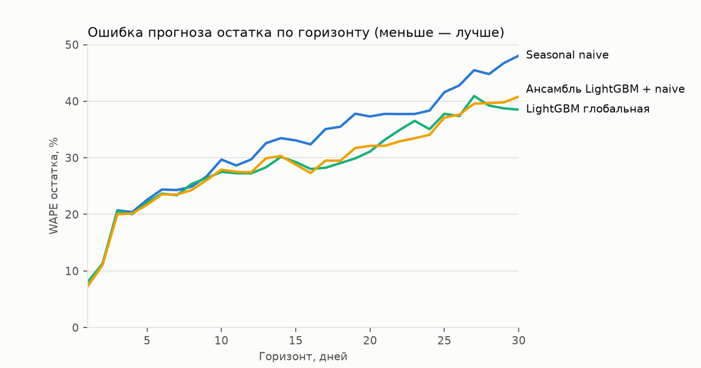
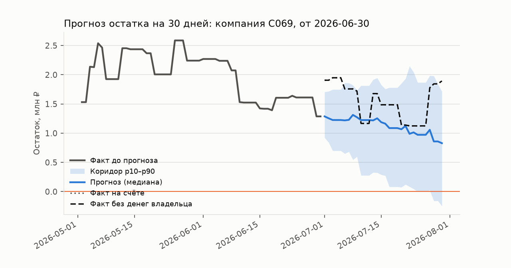

# Проверка прогноза денежных потоков

Протокол: **development**; CV по компаниям: 3; 107 компаний; 320 точек старта на модель. Даты: 2026-03-29, 2026-04-01, 2026-04-02, 2026-04-03, 2026-04-28, 2026-05-01, 2026-05-02, 2026-05-03, 2026-05-28, 2026-05-31, 2026-06-01, 2026-06-02, 2026-06-27, 2026-06-30. Горизонт 30 дней, 200 путей, seed 42.

Обучение использует только прошлое относительно даты прогноза. В development с CV каждая оцениваемая компания исключена из обучения своего fold; в audit фиксированные аудит-компании исключены из всех обучений. Обычный development без CV оценивает знакомые компании и не заменяет проверку обобщения.

Все исходные компании ранее исследовались при разработке. Это внутренняя проверка на синтетических выписках, а не независимый внешний тест и не гарантия качества на настоящем бизнесе.

## Остаток и неопределённость

Модель прогнозирует бизнес-потоки без own_transfer/owner_loan, включая регулярные зарплату, налоги и аренду. Основная цель — начальный остаток плюс эти потоки. Account — наблюдаемый остаток счёта, который дополнительно меняют переводы владельца. Эти цели нельзя смешивать.

WAPE 7/14/30 — ошибка в конкретный день горизонта. Path WAPE — ошибка по всем дням. Числа являются долями (0.25 = 25%). Покрытие p10–p90 должно быть около 0.80; слишком широкий интервал тоже нежелателен, поэтому рядом pinball loss. Relative MAE и win rate сравнивают account MAE с naive на каждой той же точке старта.

| Модель | N | Business WAPE 7 | 14 | 30 | Business path WAPE | Покрытие | Pinball | Account WAPE 30 | Relative MAE | Win rate |
|---|---|---|---|---|---|---|---|---|---|---|
| ensemble | 320 | 0.235 | 0.303 | 0.408 | 0.293 | 0.858 | 0.100 | 0.414 | 0.870 | 0.678 |
| gbm_global | 320 | 0.234 | 0.302 | 0.385 | 0.294 | 0.803 | 0.103 | 0.388 | 0.859 | 0.600 |
| seasonal_naive | 320 | 0.243 | 0.335 | 0.480 | 0.328 | 0.788 | 0.110 | 0.500 | 1.000 | 0.000 |

## Кассовые разрывы

Предупреждение совпадает с Go risk.FindGaps: первый день, где P(остаток < 0) ≥ 0.1. Вероятность события на всём горизонте считается отдельно: доля путей хотя бы с одним отрицательным остатком. Brier/ECE ниже относятся к вероятности события на горизонте. Date MAE — ошибка даты среди верно найденных событий, а не заблаговременность. Shortfall MAE — ошибка медианной нехватки по всем фактическим бизнес-разрывам, в рублях.

| Модель | Событий | Сигналов | Ложных | Precision | Recall | Brier | ECE | Date MAE, дни | Shortfall MAE, ₽ |
|---|---|---|---|---|---|---|---|---|---|
| ensemble | 49 | 151 | 104 | 0.311 | 0.959 | 0.102 | 0.117 | 9.638 | 1545085.327 |
| gbm_global | 49 | 150 | 104 | 0.307 | 0.939 | 0.098 | 0.089 | 9.283 | 1564290.204 |
| seasonal_naive | 49 | 158 | 110 | 0.304 | 0.980 | 0.121 | 0.143 | 9.688 | 1521500.241 |

Account-показатели ниже диагностические: бизнес-сценарий не моделирует будущую финансовую помощь владельца.

| Модель | Account событий | Precision | Recall | Brier | Уже ниже нуля | Новых business событий | Recall новых | Daily Brier | Daily ECE |
|---|---|---|---|---|---|---|---|---|---|
| ensemble | 12 | 0.079 | 1.000 | 0.138 | 10 | 39 | 0.949 | 0.053 | 0.072 |
| gbm_global | 12 | 0.080 | 1.000 | 0.125 | 10 | 39 | 0.923 | 0.050 | 0.048 |
| seasonal_naive | 12 | 0.076 | 1.000 | 0.165 | 10 | 39 | 0.974 | 0.065 | 0.094 |

## Сегменты доступной истории

| Сегмент | Модель | N | Path WAPE | Покрытие | Precision | Recall | Low confidence |
|---|---|---|---|---|---|---|---|
| short_under_90d | ensemble | 10 | 1.123 | 0.583 | 0.375 | 1.000 | 0.700 |
| short_under_90d | gbm_global | 10 | 1.118 | 0.570 | 0.375 | 1.000 | 0.700 |
| short_under_90d | seasonal_naive | 10 | 1.193 | 0.573 | 0.375 | 1.000 | 0.500 |
| history_with_gaps | ensemble | 15 | 0.393 | 0.800 | 0.286 | 1.000 | 0.533 |
| history_with_gaps | gbm_global | 15 | 0.393 | 0.733 | 0.400 | 1.000 | 0.000 |
| history_with_gaps | seasonal_naive | 15 | 0.449 | 0.738 | 0.250 | 1.000 | 0.533 |
| long_clean_history | ensemble | 295 | 0.279 | 0.870 | 0.309 | 0.955 | 0.003 |
| long_clean_history | gbm_global | 295 | 0.280 | 0.814 | 0.299 | 0.932 | 0.003 |
| long_clean_history | seasonal_naive | 295 | 0.313 | 0.798 | 0.303 | 0.977 | 0.000 |

## Калибровка вероятности события на горизонте

| Модель | От | До | N | Прогноз | Business факт | Account факт |
|---|---|---|---|---|---|---|
| ensemble | 0.000 | 0.200 | 188 | 0.045 | 0.011 | 0.000 |
| ensemble | 0.200 | 0.400 | 39 | 0.297 | 0.103 | 0.000 |
| ensemble | 0.400 | 0.600 | 34 | 0.509 | 0.265 | 0.000 |
| ensemble | 0.600 | 0.800 | 26 | 0.706 | 0.385 | 0.038 |
| ensemble | 0.800 | 1.000 | 33 | 0.927 | 0.727 | 0.333 |
| gbm_global | 0.000 | 0.200 | 206 | 0.041 | 0.019 | 0.000 |
| gbm_global | 0.200 | 0.400 | 36 | 0.305 | 0.111 | 0.000 |
| gbm_global | 0.400 | 0.600 | 22 | 0.493 | 0.364 | 0.045 |
| gbm_global | 0.600 | 0.800 | 19 | 0.702 | 0.526 | 0.000 |
| gbm_global | 0.800 | 1.000 | 37 | 0.917 | 0.622 | 0.297 |
| seasonal_naive | 0.000 | 0.200 | 178 | 0.040 | 0.006 | 0.000 |
| seasonal_naive | 0.200 | 0.400 | 36 | 0.289 | 0.083 | 0.000 |
| seasonal_naive | 0.400 | 0.600 | 36 | 0.506 | 0.278 | 0.000 |
| seasonal_naive | 0.600 | 0.800 | 26 | 0.699 | 0.346 | 0.038 |
| seasonal_naive | 0.800 | 1.000 | 44 | 0.927 | 0.591 | 0.250 |

## Контролируемое ухудшение входа

Будущий факт неизменен. short — только последние N дней; gap_14 — скрытые 14 дней перед последней неделей; missing_30pct — детерминированно скрытые 30% дней. Это стресс-проверка, а не новый независимый датасет.

| Сценарий | Модель | N | Path WAPE | Покрытие | Precision | Recall | Low confidence |
|---|---|---|---|---|---|---|---|
| gap_14 | ensemble | 320 | 0.304 | 0.811 | 0.276 | 0.918 | 0.078 |
| gap_14 | gbm_global | 320 | 0.293 | 0.769 | 0.293 | 0.939 | 0.047 |
| gap_14 | seasonal_naive | 320 | 0.362 | 0.737 | 0.282 | 0.939 | 0.056 |
| missing_30pct | ensemble | 320 | 0.291 | 0.823 | 0.318 | 0.980 | 1.000 |
| missing_30pct | gbm_global | 320 | 0.288 | 0.804 | 0.340 | 0.980 | 1.000 |
| missing_30pct | seasonal_naive | 320 | 0.345 | 0.719 | 0.296 | 0.959 | 0.675 |
| short_14 | ensemble | 320 | 0.476 | 0.473 | 0.289 | 0.837 | 1.000 |
| short_14 | gbm_global | 320 | 0.482 | 0.472 | 0.296 | 0.857 | 1.000 |
| short_14 | seasonal_naive | 320 | 0.477 | 0.473 | 0.287 | 0.837 | 1.000 |
| short_28 | ensemble | 320 | 0.364 | 0.680 | 0.293 | 0.939 | 1.000 |
| short_28 | gbm_global | 320 | 0.365 | 0.681 | 0.286 | 0.939 | 1.000 |
| short_28 | seasonal_naive | 320 | 0.364 | 0.682 | 0.289 | 0.939 | 1.000 |
| short_56 | ensemble | 320 | 0.286 | 0.863 | 0.340 | 0.980 | 0.991 |
| short_56 | gbm_global | 320 | 0.304 | 0.823 | 0.395 | 0.959 | 0.991 |
| short_56 | seasonal_naive | 320 | 0.328 | 0.788 | 0.304 | 0.980 | 0.041 |

Пример выбран по медианной ошибке модели, а не по удачно предсказанному разрыву.

## Воспроизводимость

Вход: `21d1e925e6d9ca1450e9d5254dd3e57ea6a6c6ad72096eb6bd0a2da307c668c5`.
Код на старте: `25f4378d5de893efaa2108ec2d9f22c2a6211c693bf27357b6ae09ecde0d288a`.
Код менялся во время прогона: `True`.
Полные результаты и настройки: `night_stress.parquet`, `night_stress.metadata.json`.
