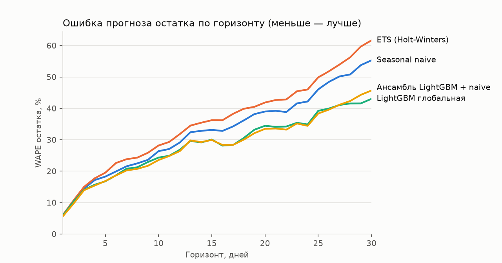
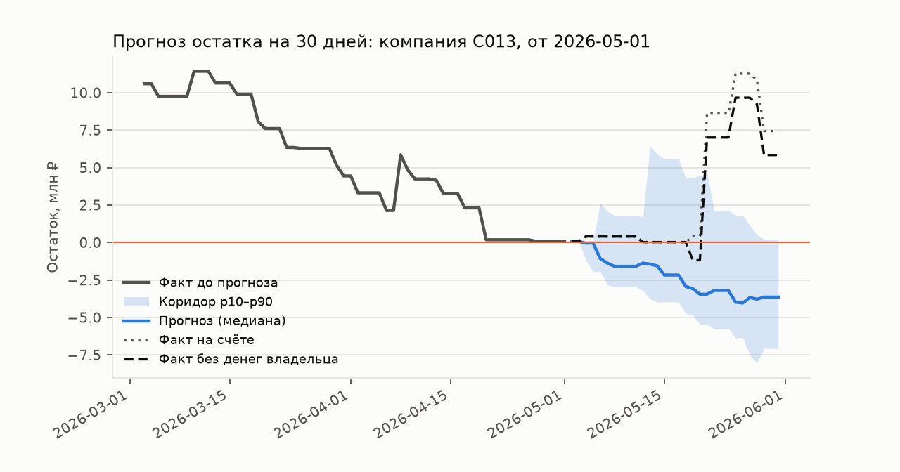

# Качество прогноза остатка

Бэктест на датасете кейса: 139 компаний с подходящей историей,
749 прогонов на модель, горизонт 30 дней, 6 точек старта на компанию с шагом
30 дней.

**Все компании оценены как новые для модели** — кросс-валидация по компаниям
на 5 групп: глобальная модель учится без группы и прогнозирует только её. Так
мы имитируем проверку экспертами на своём наборе данных. Дополнительно модель
переобучается раз в месяц и видит только прошлое относительно точки старта.

- **WAPE** — суммарная абсолютная ошибка медианы прогноза остатка / сумма |остатка|.
- **WAPE (бизнес)** — то же против остатка без переводов владельца (займы
  учредителя, переводы своих средств): их не предсказать по потокам бизнеса.
- **Покрытие p10–p90** — доля дней, когда факт внутри коридора (цель — 80%).
- **Ошибка к naive** — средняя (геометрическая) по прогонам ошибка модели,
  делённая на ошибку seasonal naive на том же прогоне: не зависит от размера
  компании, < 1 — лучше бейзлайна. **Лучше naive** — доля таких прогонов.
- **Разрывы** — остаток без докачки владельцем уходит ниже нуля на горизонте;
  прогноз разрыва — вероятность ≥ 30%. «За сколько дней» — как рано увидели.

| Модель | Компании | Прогонов | WAPE 7д | WAPE 14д | WAPE 30д | Покрытие p10–p90 | WAPE 30д (бизнес) | Ошибка к naive | Лучше naive | Разрывы: AUC | Разрывы: точность | Разрывы: полнота | За сколько дней |
|---|---|---|---|---|---|---|---|---|---|---|---|---|---|
| Ансамбль LightGBM + naive | все | 749 | 20.3% | 29.3% | 45.7% | 83.7% | 41.7% | 0.85 | 67.8% | 0.897 | 38.3% | 88.2% | 11.0 |
| ETS (Holt-Winters) | все | 749 | 23.8% | 35.4% | 61.6% | 71.4% | 54.8% | 1.11 | 44.6% | 0.887 | 37.5% | 85.3% | 10.4 |
| LightGBM глобальная | все | 749 | 20.8% | 29.1% | 43.0% | 75.6% | 40.8% | 0.86 | 61.3% | 0.873 | 40.5% | 81.4% | 10.3 |
| Seasonal naive | все | 749 | 21.6% | 32.8% | 55.3% | 78.0% | 48.6% | 1.0 | — | 0.897 | 36.4% | 90.2% | 11.2 |

## По отраслям (WAPE 30 дней)

| Отрасль | Seasonal naive | ETS (Holt-Winters) | LightGBM глобальная | Ансамбль LightGBM + naive |
|---|---|---|---|---|
| Розница: продуктовый магазин | 20% | 26% | 18% | 17% |
| Медицинская клиника / стоматология | 32% | 36% | 25% | 25% |
| Автосервис | 36% | 30% | 30% | 29% |
| Производство мебели на заказ | 41% | 42% | 26% | 30% |
| Розница: одежда и обувь | 44% | 35% | 45% | 43% |
| Оптовая торговля | 45% | 48% | 32% | 38% |
| Салон красоты | 49% | 36% | 44% | 44% |
| Общепит (кофейня, кафе) | 49% | 46% | 39% | 40% |
| Грузоперевозки | 50% | 49% | 35% | 41% |
| Продажи на маркетплейсах | 50% | 88% | 49% | 38% |
| Гостиница / база отдыха | 54% | 69% | 43% | 50% |
| IT-услуги и разработка | 77% | 73% | 59% | 62% |
| Строительство и ремонт | 87% | 118% | 78% | 72% |
| Образовательный центр для детей | 98% | 114% | 57% | 71% |
| Сельское хозяйство (растениеводство) | 136% | 129% | 104% | 109% |

Хуже всего прогнозируются отрасли с редкими крупными B2B-платежами и сильной
сезонностью (сельское хозяйство, строительство, детские центры): там одна
оплата клиента сопоставима с месячным оборотом.

