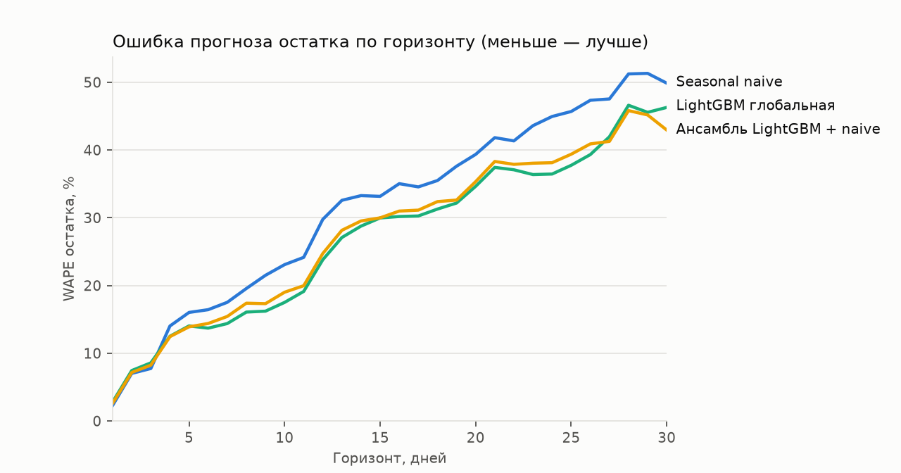
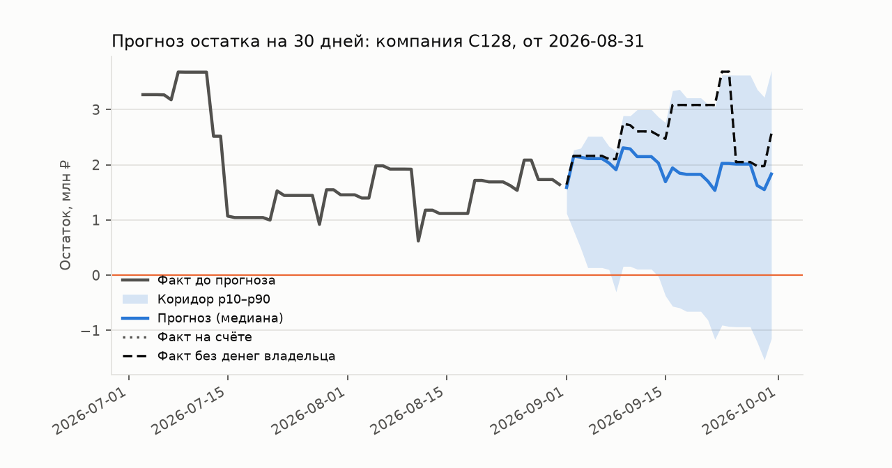

# Проверка прогноза денежных потоков

Протокол: **audit**; CV по компаниям: 0; 30 компаний; 86 точек старта на модель. Даты: 2026-07-01, 2026-07-02, 2026-07-30, 2026-07-31, 2026-08-01, 2026-08-29, 2026-08-30, 2026-08-31. Горизонт 30 дней, 600 путей, seed 42.

Обучение использует только прошлое относительно даты прогноза. В development с CV каждая оцениваемая компания исключена из обучения своего fold; в audit фиксированные аудит-компании исключены из всех обучений. Обычный development без CV оценивает знакомые компании и не заменяет проверку обобщения.

Все исходные компании ранее исследовались при разработке. Это внутренняя проверка на синтетических выписках, а не независимый внешний тест и не гарантия качества на настоящем бизнесе.

## Остаток и неопределённость

Модель прогнозирует бизнес-потоки без own_transfer/owner_loan, включая регулярные зарплату, налоги и аренду. Основная цель — начальный остаток плюс эти потоки. Account — наблюдаемый остаток счёта, который дополнительно меняют переводы владельца. Эти цели нельзя смешивать.

WAPE 7/14/30 — ошибка в конкретный день горизонта. Path WAPE — ошибка по всем дням. Числа являются долями (0.25 = 25%). Покрытие p10–p90 должно быть около 0.80; слишком широкий интервал тоже нежелателен, поэтому рядом pinball loss. Relative MAE и win rate сравнивают account MAE с naive на каждой той же точке старта.

| Модель | N | Business WAPE 7 | 14 | 30 | Business path WAPE | Покрытие | Pinball | Account WAPE 30 | Relative MAE | Win rate |
|---|---|---|---|---|---|---|---|---|---|---|
| auto | 86 | 0.156 | 0.301 | 0.443 | 0.288 | 0.860 | 0.096 | 0.488 | 0.872 | 0.628 |
| ensemble | 86 | 0.154 | 0.295 | 0.429 | 0.284 | 0.857 | 0.096 | 0.475 | 0.873 | 0.628 |
| gbm_global | 86 | 0.144 | 0.288 | 0.463 | 0.279 | 0.833 | 0.097 | 0.491 | 0.852 | 0.593 |
| seasonal_naive | 86 | 0.175 | 0.333 | 0.499 | 0.323 | 0.818 | 0.106 | 0.574 | 1.000 | 0.000 |

## Кассовые разрывы

Предупреждение совпадает с Go risk.FindGaps: первый день, где P(остаток < 0) ≥ 0.1. Вероятность события на всём горизонте считается отдельно: доля путей хотя бы с одним отрицательным остатком. Brier/ECE ниже относятся к вероятности события на горизонте. Date MAE — ошибка даты среди верно найденных событий, а не заблаговременность. Shortfall MAE — ошибка медианной нехватки по всем фактическим бизнес-разрывам, в рублях.

| Модель | Событий | Сигналов | Ложных | Precision | Recall | Brier | ECE | Date MAE, дни | Shortfall MAE, ₽ |
|---|---|---|---|---|---|---|---|---|---|
| auto | 9 | 37 | 28 | 0.243 | 1.000 | 0.084 | 0.157 | 4.778 | 1593773.845 |
| ensemble | 9 | 38 | 29 | 0.237 | 1.000 | 0.083 | 0.156 | 4.778 | 1558680.531 |
| gbm_global | 9 | 35 | 26 | 0.257 | 1.000 | 0.084 | 0.145 | 4.556 | 2024480.236 |
| seasonal_naive | 9 | 39 | 30 | 0.231 | 1.000 | 0.097 | 0.169 | 4.889 | 1486591.970 |

Account-показатели ниже диагностические: бизнес-сценарий не моделирует будущую финансовую помощь владельца.

| Модель | Account событий | Precision | Recall | Brier | Уже ниже нуля | Новых business событий | Recall новых | Daily Brier | Daily ECE |
|---|---|---|---|---|---|---|---|---|---|
| auto | 5 | 0.135 | 1.000 | 0.119 | 5 | 4 | 1.000 | 0.042 | 0.083 |
| ensemble | 5 | 0.132 | 1.000 | 0.118 | 5 | 4 | 1.000 | 0.042 | 0.084 |
| gbm_global | 5 | 0.143 | 1.000 | 0.121 | 5 | 4 | 1.000 | 0.042 | 0.070 |
| seasonal_naive | 5 | 0.128 | 1.000 | 0.128 | 5 | 4 | 1.000 | 0.050 | 0.097 |

## Сегменты доступной истории

| Сегмент | Модель | N | Path WAPE | Покрытие | Precision | Recall | Low confidence |
|---|---|---|---|---|---|---|---|
| short_under_90d | auto | 1 | 0.265 | 1.000 | 0.000 | — | 1.000 |
| short_under_90d | ensemble | 1 | 0.235 | 1.000 | 0.000 | — | 1.000 |
| short_under_90d | gbm_global | 1 | 0.243 | 1.000 | 0.000 | — | 1.000 |
| short_under_90d | seasonal_naive | 1 | 0.296 | 1.000 | 0.000 | — | 0.000 |
| history_with_gaps | auto | 5 | 0.380 | 0.533 | — | — | 0.000 |
| history_with_gaps | ensemble | 5 | 0.390 | 0.533 | 0.000 | — | 0.000 |
| history_with_gaps | gbm_global | 5 | 0.364 | 0.520 | — | — | 0.000 |
| history_with_gaps | seasonal_naive | 5 | 0.398 | 0.520 | 0.000 | — | 0.000 |
| long_clean_history | auto | 80 | 0.285 | 0.878 | 0.250 | 1.000 | 0.000 |
| long_clean_history | ensemble | 80 | 0.280 | 0.875 | 0.250 | 1.000 | 0.000 |
| long_clean_history | gbm_global | 80 | 0.276 | 0.850 | 0.265 | 1.000 | 0.000 |
| long_clean_history | seasonal_naive | 80 | 0.320 | 0.834 | 0.243 | 1.000 | 0.000 |

## Калибровка вероятности события на горизонте

| Модель | От | До | N | Прогноз | Business факт | Account факт |
|---|---|---|---|---|---|---|
| auto | 0.000 | 0.200 | 53 | 0.042 | 0.000 | 0.000 |
| auto | 0.200 | 0.400 | 12 | 0.303 | 0.000 | 0.000 |
| auto | 0.400 | 0.600 | 4 | 0.518 | 0.000 | 0.000 |
| auto | 0.600 | 0.800 | 6 | 0.696 | 0.167 | 0.000 |
| auto | 0.800 | 1.000 | 11 | 0.943 | 0.727 | 0.455 |
| ensemble | 0.000 | 0.200 | 53 | 0.043 | 0.000 | 0.000 |
| ensemble | 0.200 | 0.400 | 12 | 0.301 | 0.000 | 0.000 |
| ensemble | 0.400 | 0.600 | 4 | 0.518 | 0.000 | 0.000 |
| ensemble | 0.600 | 0.800 | 7 | 0.708 | 0.143 | 0.000 |
| ensemble | 0.800 | 1.000 | 10 | 0.956 | 0.800 | 0.500 |
| gbm_global | 0.000 | 0.200 | 54 | 0.028 | 0.000 | 0.000 |
| gbm_global | 0.200 | 0.400 | 13 | 0.302 | 0.000 | 0.000 |
| gbm_global | 0.400 | 0.600 | 3 | 0.523 | 0.000 | 0.000 |
| gbm_global | 0.600 | 0.800 | 5 | 0.772 | 0.200 | 0.000 |
| gbm_global | 0.800 | 1.000 | 11 | 0.962 | 0.727 | 0.455 |
| seasonal_naive | 0.000 | 0.200 | 47 | 0.023 | 0.000 | 0.000 |
| seasonal_naive | 0.200 | 0.400 | 13 | 0.279 | 0.000 | 0.000 |
| seasonal_naive | 0.400 | 0.600 | 8 | 0.468 | 0.000 | 0.000 |
| seasonal_naive | 0.600 | 0.800 | 7 | 0.683 | 0.143 | 0.000 |
| seasonal_naive | 0.800 | 1.000 | 11 | 0.940 | 0.727 | 0.455 |

Пример выбран по медианной ошибке модели, а не по удачно предсказанному разрыву.

## Воспроизводимость

Вход: `21d1e925e6d9ca1450e9d5254dd3e57ea6a6c6ad72096eb6bd0a2da307c668c5`.
Код на старте: `ecf8c0e8bab309a0849b476bd9f10b887a29dda9ea09eaaa475dd269baa5863f`.
Код менялся во время прогона: `False`.
Полные результаты и настройки: `final_audit.parquet`, `final_audit.metadata.json`.
