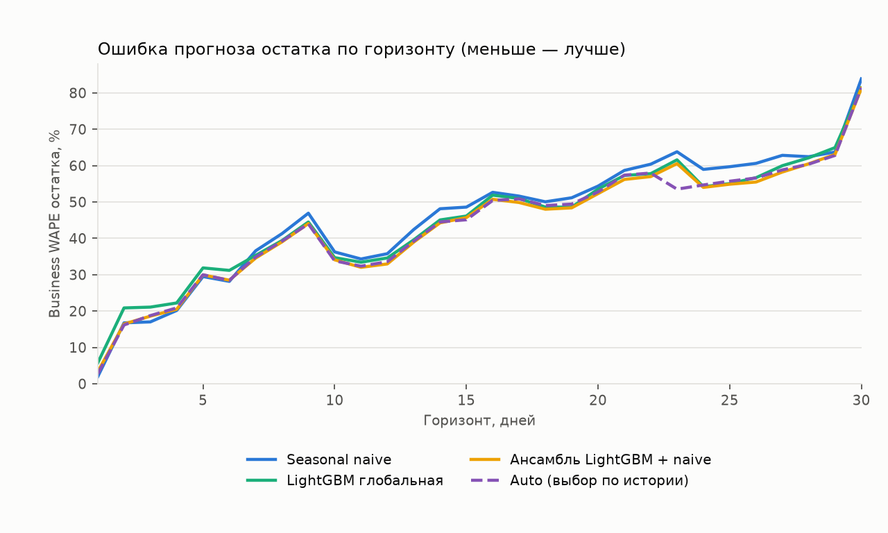
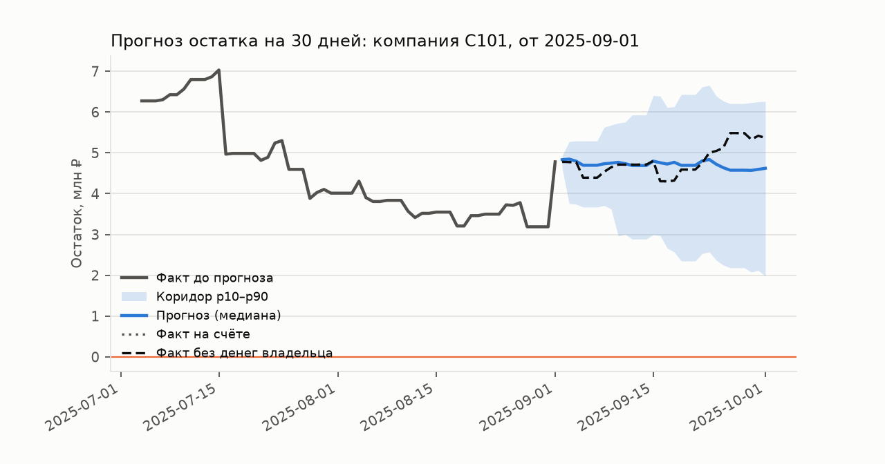

# Дополнительная проверка 13 компаний

Отдельный причинный прогон для 7 рано завершившихся и 6 поздно начатых компаний, не вошедших в основное временное окно. Все 13 компаний и все 30 audit-компаний исключены из каждого fit. Глобальная модель обучается на остальных 107 компаниях только до соответствующего месячного cutoff. Результаты не объединяются с основным аудитом; настройки по ним не подбирались.

Протокол: **supplemental_unseen_companies**; CV по компаниям: 0; 13 компаний; 54 точек старта на модель. Даты: 2025-04-20, 2025-05-20, 2025-06-19, 2025-07-03, 2025-07-18, 2025-07-19, 2025-08-02, 2025-08-17, 2025-08-18, 2025-09-01, 2025-09-16, 2025-09-17, 2025-09-25, 2025-10-01, 2025-10-12, 2025-10-16, 2025-10-24, 2025-10-25, 2025-10-31, 2025-11-11, 2025-11-15, 2025-11-23, 2025-11-24, 2025-11-30, 2025-12-11, 2025-12-15, 2025-12-23, 2025-12-24, 2026-01-10, 2026-01-22, 2026-01-23, 2026-02-09, 2026-02-21, 2026-02-22, 2026-03-11, 2026-03-23, 2026-07-02, 2026-08-01, 2026-08-31. Горизонт 30 дней, 600 путей, seed 42.

Обучение использует только прошлое относительно даты прогноза. В development с CV каждая оцениваемая компания исключена из обучения своего fold; в audit фиксированные аудит-компании исключены из всех обучений. Обычный development без CV оценивает знакомые компании и не заменяет проверку обобщения.

Все исходные компании ранее исследовались при разработке. Это внутренняя проверка на синтетических выписках, а не независимый внешний тест и не гарантия качества на настоящем бизнесе.

## Остаток и неопределённость

Модель прогнозирует бизнес-потоки без own_transfer/owner_loan, включая регулярные зарплату, налоги и аренду. Основная цель — начальный остаток плюс эти потоки. Account — наблюдаемый остаток счёта, который дополнительно меняют переводы владельца. Эти цели нельзя смешивать.

WAPE 7/14/30 — ошибка в конкретный день горизонта. Path WAPE — ошибка по всем дням. Числа являются долями (0.25 = 25%). Покрытие p10–p90 должно быть около 0.80; слишком широкий интервал тоже нежелателен, поэтому рядом pinball loss. Relative MAE и win rate сравнивают account MAE с naive на каждой той же точке старта.

| Модель | N | Business WAPE 7 | 14 | 30 | Business path WAPE | Покрытие | Pinball | Account WAPE 30 | Relative MAE | Win rate |
|---|---|---|---|---|---|---|---|---|---|---|
| auto | 54 | 0.349 | 0.445 | 0.814 | 0.451 | 0.809 | 0.182 | 0.769 | 0.788 | 0.685 |
| ensemble | 54 | 0.346 | 0.443 | 0.813 | 0.450 | 0.805 | 0.182 | 0.767 | 0.789 | 0.704 |
| gbm_global | 54 | 0.353 | 0.451 | 0.813 | 0.462 | 0.749 | 0.178 | 0.762 | 0.862 | 0.630 |
| seasonal_naive | 54 | 0.366 | 0.481 | 0.839 | 0.473 | 0.775 | 0.195 | 0.816 | 1.000 | 0.000 |

## Кассовые разрывы

Предупреждение совпадает с Go risk.FindGaps: первый день, где P(остаток < 0) ≥ 0.1. Вероятность события на всём горизонте считается отдельно: доля путей хотя бы с одним отрицательным остатком. Brier/ECE ниже относятся к вероятности события на горизонте. Date MAE — ошибка даты среди верно найденных событий, а не заблаговременность. Shortfall MAE — ошибка медианной нехватки по всем фактическим бизнес-разрывам, в рублях.

| Модель | Событий | Сигналов | Ложных | Precision | Recall | Brier | ECE | Date MAE, дни | Shortfall MAE, ₽ |
|---|---|---|---|---|---|---|---|---|---|
| auto | 17 | 26 | 11 | 0.577 | 0.882 | 0.128 | 0.100 | 5.600 | 1886556.372 |
| ensemble | 17 | 26 | 11 | 0.577 | 0.882 | 0.127 | 0.106 | 5.800 | 2023568.086 |
| gbm_global | 17 | 26 | 11 | 0.577 | 0.882 | 0.129 | 0.102 | 5.400 | 2034567.675 |
| seasonal_naive | 17 | 29 | 14 | 0.517 | 0.882 | 0.140 | 0.109 | 6.133 | 2025136.115 |

Account-показатели ниже диагностические: бизнес-сценарий не моделирует будущую финансовую помощь владельца.

| Модель | Account событий | Precision | Recall | Brier | Уже ниже нуля | Новых business событий | Recall новых | Daily Brier | Daily ECE |
|---|---|---|---|---|---|---|---|---|---|
| auto | 8 | 0.308 | 1.000 | 0.162 | 7 | 10 | 0.800 | 0.109 | 0.063 |
| ensemble | 8 | 0.308 | 1.000 | 0.168 | 7 | 10 | 0.800 | 0.109 | 0.066 |
| gbm_global | 8 | 0.308 | 1.000 | 0.164 | 7 | 10 | 0.800 | 0.120 | 0.086 |
| seasonal_naive | 8 | 0.276 | 1.000 | 0.179 | 7 | 10 | 0.800 | 0.114 | 0.077 |

## Сегменты доступной истории

| Сегмент | Модель | N | Path WAPE | Покрытие | Precision | Recall | Low confidence |
|---|---|---|---|---|---|---|---|
| actual_short_under_90d | auto | 11 | 1.142 | 0.706 | 0.333 | 0.750 | 1.000 |
| actual_short_under_90d | ensemble | 11 | 1.144 | 0.712 | 0.333 | 0.750 | 1.000 |
| actual_short_under_90d | gbm_global | 11 | 1.125 | 0.715 | 0.333 | 0.750 | 1.000 |
| actual_short_under_90d | seasonal_naive | 11 | 1.226 | 0.636 | 0.333 | 0.750 | 0.636 |
| long_history | auto | 43 | 0.271 | 0.835 | 0.706 | 0.923 | 0.023 |
| long_history | ensemble | 43 | 0.269 | 0.829 | 0.706 | 0.923 | 0.023 |
| long_history | gbm_global | 43 | 0.289 | 0.758 | 0.706 | 0.923 | 0.023 |
| long_history | seasonal_naive | 43 | 0.277 | 0.810 | 0.600 | 0.923 | 0.000 |

Пример выбран по медианной ошибке модели, а не по удачно предсказанному разрыву.

## Воспроизводимость

Вход: `21d1e925e6d9ca1450e9d5254dd3e57ea6a6c6ad72096eb6bd0a2da307c668c5`.
Код на старте: `ecf8c0e8bab309a0849b476bd9f10b887a29dda9ea09eaaa475dd269baa5863f`.
Код менялся во время прогона: `False`.
Полные результаты и настройки: `supplemental_cohort.parquet`, `supplemental_cohort.metadata.json`.
